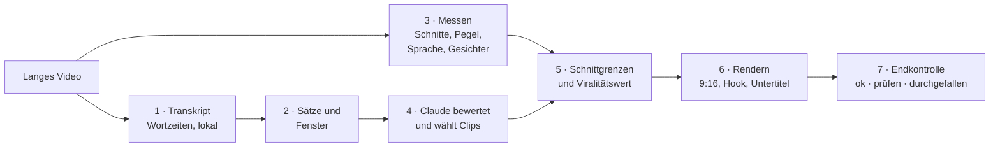

# Shortomation


Ein Claude-Skill auf Deutsch, der aus einem langen Video mit Sprache fertige Hochkant-Shorts macht. Er findet die
stärksten Momente, gibt jedem einen Viralitätswert, schneidet wortgenau, folgt bei Podcasts der Person, die gerade
spricht, setzt Hook und Untertitel im Takt der Wörter und prüft jeden Short, bevor du ihn siehst. Alles läuft auf
deinem Rechner, das Video wird nirgends hochgeladen.

Gebaut für Dokus, Erklärvideos, Podcasts, Interviews und Vorträge.

[English summary](#english-summary)

## Was du bekommst

- **3 bis 10 Shorts** je Video: 1080x1920, 30 fps, H.264, Lautheit −14 LUFS, dazu ein Vorschaubild.
- **Eine Rangliste** (`SCORES.md`) mit Viralitätswert: 65 % Inhalt (Hook, Verständlichkeit ohne Vorwissen,
  Auflösung, Fallhöhe, Überraschung, Diskussionsstoff), 35 % Messung (Länge, Sprechtempo, Pausen, Bildwechsel).
- **Wortgenaue Schnitte:** Wortzeiten aus der lokalen Spracherkennung, Schnitt erst nach dem letzten Laut, auch wenn
  er geflüstert ist oder unter Musik liegt.
- **Sprecher im Bild:** Bei Podcasts und Interviews zeigt der Short die Person, die gerade spricht, und schneidet
  am Satzanfang hart zur anderen. Gesichter werden dafür nur gefunden, nicht erkannt.
- **Einen Prüfbericht** (`CHECK.md`): Bildgröße, Länge, Lautheit, kein angeschnittenes Wort an den Schnitten,
  auf Wunsch jedes Stück neu erkannt und mit dem geplanten Text abgeglichen.
- **Warnungen** bei Musik mit Content-ID-Anspruch, Material mit Namensnennungspflicht (CC BY) und Clips mit
  Vorwürfen gegen benannte Personen.

Der Viralitätswert ist eine Rangfolge, keine Vorhersage von Aufrufen.

## So funktioniert es



Die Schritte 1 bis 3 und 5 bis 7 sind Python-Skripte, die auf deinem Rechner laufen. In Schritt 4 liest Claude das
Transkript und bewertet jedes Fenster nach einem festen Raster.

## Voraussetzungen

| Was | Wofür | Pflicht |
| --- | --- | --- |
| Claude Code | Skill ausführen, Momente bewerten | ja |
| Python 3.10 oder neuer | Schnitt, Messung, Rendern | ja |
| ffmpeg und ffprobe | Video lesen und schreiben | ja |
| numpy, Pillow, faster-whisper | aus `requirements.txt` (bringt onnxruntime für Sprach- und Gesichtserkennung mit) | ja |

**Windows (PowerShell):**

```powershell
winget install Python.Python.3.12
winget install Gyan.FFmpeg
```

**Mac (Terminal):**

```bash
brew install python ffmpeg
```

Danach ein neues Terminal öffnen und prüfen: `python --version` und `ffmpeg -version`.

Beim ersten Lauf lädt faster-whisper das Sprachmodell einmal herunter (Modell „small“, rund 500 MB). Danach läuft
die Erkennung ohne Internet. Das Gesichtsmodell (230 KB) liegt schon im Skill.

## Einrichten

**Als Plugin in Claude Code** (zwei Befehle in einem Claude-Code-Fenster):

```
/plugin marketplace add memobautki/shortomation
/plugin install shortomation@shortomation
```

**Oder von Hand:** Den Ordner `skills/shortomation` nach `~/.claude/skills/shortomation` kopieren.

**Python-Pakete:** Beim ersten Lauf legt Claude im Ordner des Skills eine eigene Python-Umgebung (`.venv`) an und
installiert numpy, Pillow und faster-whisper daraus. Es fragt vorher. Von Hand geht es so (im Ordner
`skills/shortomation`, bzw. dort, wohin du ihn kopiert hast):

```powershell
# Windows
py -m venv .venv
.venv\Scripts\pip install -r requirements.txt
```

```bash
# Mac / Linux
python3 -m venv .venv
.venv/bin/pip install -r requirements.txt
```

## Benutzen

Sag Claude zum Beispiel:

```text
Mach mir Shorts aus C:\Videos\folge12.mp4. Die Untertitel liegen daneben als folge12.srt.
```

Claude führt dann diese Schritte aus (Details in `skills/shortomation/SKILL.md`):

1. `transcribe.py`: Transkript mit Wortzeiten (lokal, faster-whisper; mit SRT die richtige Schreibweise)
2. `windows.py`: Sätze und Fenster von etwa 75 s
3. `analyze.py`: Schnitte, Bildbewegung, Pegel, Sprache, Stichprobe der Gesichter
4. Claude bewertet jedes Fenster und wählt die Clips und den Bildzuschnitt (`clips.json`)
5. `score.py`: Schnittgrenzen und Viralitätswert
6. `render.py`: die fertigen Shorts
7. `check.py`: Prüfung, erst danach bekommst du die Shorts

Alles landet in einem Arbeitsordner, zum Beispiel `folge12/shorts/`:

```
shorts/
├── words.json · sentences.json · transcript.md · analysis.json
├── clips.json · clips.scored.json · SCORES.md · CHECK.md
└── out/
    ├── k01.mp4 · k01_cover.jpg
    └── k02.mp4 · k02_cover.jpg
```

### Bildzuschnitt

| `layout` | Wann |
| --- | --- |
| `content` (Standard) | Tafeln, Dokumente, Folien auf dunklem Grund: der Ausschnitt folgt dem Inhalt |
| `face` | Podcast, Interview, Vlog: der Ausschnitt folgt dem Gesicht, bei mehreren Personen der, die spricht |
| `full` | Das ganze Bild bleibt sichtbar |
| `center` | Eine Person in der Bildmitte füllt die Fläche |

Ist im Video meistens eine Person zu sehen, wählt Claude `face` von selbst. Einstellungen ohne Gesicht schneidet
`face` wie `content`.

**So entscheidet `face`, wer spricht:** Je Einstellung findet das Modell YuNet zehnmal pro Sekunde die Gesichter
samt Augen, Nase und Mundwinkeln. Während gesprochen wird, zeigt die Mundbewegung, wer redet. Gewechselt wird erst,
wenn das 0,6 s lang klar ist, frühestens 1,5 s nach dem letzten Wechsel und möglichst genau an einem Satzanfang.
Ein kurzes Lachen oder Nicken löst keinen Wechsel aus. Die anderen Personen bleiben aus dem Bild, wenn es mit
höchstens doppelter Vergrößerung geht.

### Eigener Look

Farben, Größen und Schriften lassen sich in `clips.json` unter `style` ändern. Beispiel und alle Werte in
`SKILL.md`, Abschnitt „Stil anpassen“.

## Grenzen

- Der Skill braucht **Sprache** im Video. Reine Musik- oder Gameplay-Videos ohne Kommentar kann er nicht bewerten.
- **Wer spricht**, erkennt `face` an der Mundbewegung. Das klappt am besten bei Gesichtern von vorn und fester
  Kamera. Im Profil, mit der Hand vor dem Mund oder wenn beide gleichzeitig reden, kann das Bild zur falschen
  Person springen. Dann den Kontaktabzug ansehen und den Clip mit `full` rendern.
- `face` vergrößert höchstens doppelt. Sehr kleine Gesichter in einer weiten Totale bleiben klein.
- **Sätze ohne Pause:** Gehen zwei Sätze nahtlos ineinander über, schneidet er an der leisesten Stelle zwischen den
  Wörtern und markiert den Short mit „prüfen“. Dann einmal anhören oder den Clip einen Satz länger wählen.
- **Flüstern unter lauter Musik** kann die Sprach-Erkennung übersehen. Auch dann steht „prüfen“ im Bericht, wenn am
  Schnitt ein leiser Laut liegt.
- **Content-ID** erkennt er nicht selbst. Die beanstandeten Bereiche trägst du aus YouTube Studio ein, dann schneidet
  er drumherum und warnt.
- Die **Erkennung auf der CPU** dauert etwa ein Viertel der Videolänge (Modell „small“). Der Zuschnitt `face`
  braucht beim Rendern etwa eine halbe Sekunde Rechenzeit je Sekunde Short zusätzlich.
- Der **Viralitätswert** ist eine begründete Rangfolge. Ob ein Short läuft, entscheiden die Zuschauer.
- Veröffentliche nur Videos, an denen du die Rechte hast oder für die du eine Erlaubnis hast. Das gilt auch für
  Gäste im Podcast.

## Datenschutz

Das Video und der Ton bleiben auf deinem Rechner. Sprach- und Gesichtserkennung laufen lokal. Gesichter werden nur
gefunden (wo ist ein Gesicht, bewegt sich der Mund), nicht erkannt: Der Skill vergleicht keine Gesichter mit
Personen, speichert keine Gesichtsmerkmale und weiß nicht, wer im Bild ist. Claude liest den Text des Transkripts,
um die Momente zu bewerten; das geht wie jede Unterhaltung an deinen Claude-Zugang. Es gibt keine Telemetrie und
keine weiteren Dienste.

## Prüfen

```bash
python -m unittest discover -s tests -v
```

77 Tests. Die Unit-Tests prüfen Satzbildung, SRT-Abgleich, Schnittgrenzen (auch Flüstern über Raumton), die
Eingabeprüfung und den Zuschnitt `face`: Auslesen des Gesichtsmodells, Personen über mehrere Bilder verfolgen,
Poster und Vorbeilaufende ignorieren, Ausschnitt ohne die Nachbarperson, Sprecherwechsel am Satzanfang, kein
Wechsel bei kurzem Lachen oder ohne Sprache.

Die Ende-zu-Ende-Tests bauen künstliche Videos: eines mit leise ausklingendem letztem Wort (1280x720, 25 fps), eines
mit sechs Tonstößen, bei denen das Bild genau mit dem Ton aufleuchtet (in `full` und in `face`), und eine leise
Aufnahme mit lauten Spitzen, die trotzdem −14 LUFS erreichen muss. Geprüft werden Format, Länge, der erhaltene
Ausklang und dass Bild und Ton nach sechs Schnitten und Tempo 1,1 höchstens ein Bild auseinanderliegen. Die Tests
brauchen ffmpeg, aber kein Sprachmodell und kein Internet. Kein Test verwendet Bilder echter Personen.

## Lizenz

Code: MIT, siehe `LICENSE`. Schriften in `skills/shortomation/assets/fonts`: SIL Open Font License 1.1
(Big Shoulders Stencil Display, IBM Plex Sans, IBM Plex Mono), Lizenztexte liegen daneben. Gesichtsmodell
`skills/shortomation/assets/models/face_detection_yunet_2023mar.onnx`: YuNet aus dem OpenCV Model Zoo, MIT,
Lizenztext daneben.

---

## English summary

**Shortomation** is a Claude Code skill that turns a long talking video (documentary, explainer, podcast,
interview, talk) into finished vertical shorts. Everything runs on your machine; the video is never uploaded.

- **Finds the best moments** and ranks them with a virality score: 65 % content rubric judged by Claude (hook,
  stands alone, payoff, stakes, surprise, comment potential), 35 % measurements (length, speech rate, pauses,
  cuts). The score is a ranking, not a view forecast.
- **Cuts on the word:** local word timestamps (faster-whisper) plus level and voice-activity detection (Silero VAD)
  keep the last word, even when it is whispered or sits under music.
- **Follows the speaker:** in podcasts and interviews the frame shows whoever is talking, detected from mouth
  movement during speech, with a hard cut at the start of a sentence. Faces are only detected (YuNet, local),
  never identified.
- **Renders** 1080x1920, 30 fps, H.264, −14 LUFS, with a hook title and word-timed captions. No browser, no Node.
- **Checks every short** before you see it (size, length, loudness, no clipped word at any cut) and writes a
  report: ok, review, or failed.
- **Warns** about Content ID music, CC BY attribution and clips with accusations against named people.

Install in Claude Code:

```
/plugin marketplace add memobautki/shortomation
/plugin install shortomation@shortomation
```

You need Python 3.10+ and ffmpeg. On first use Claude asks before it creates a local virtual environment and
installs `requirements.txt` (numpy, Pillow, faster-whisper). Then say, for example, *"Make shorts from
C:\Videos\episode12.mp4"*.

The instructions, reports and scoring rubric are in German, and the skill is tuned and tested on German speech.
Other languages can be transcribed with `--language`, but captions, hooks and checks have not been tested for them.

License: MIT. Fonts: SIL OFL 1.1. Face model: YuNet (OpenCV Model Zoo), MIT.

Von memo.baut.ki
